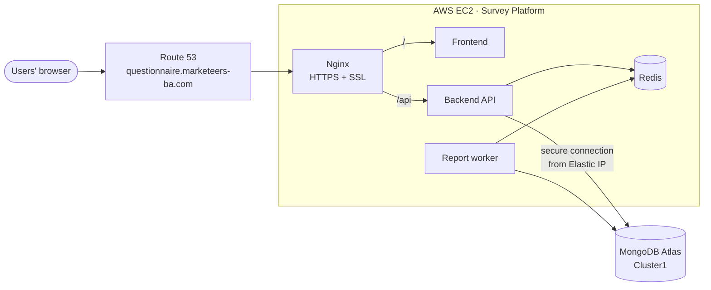
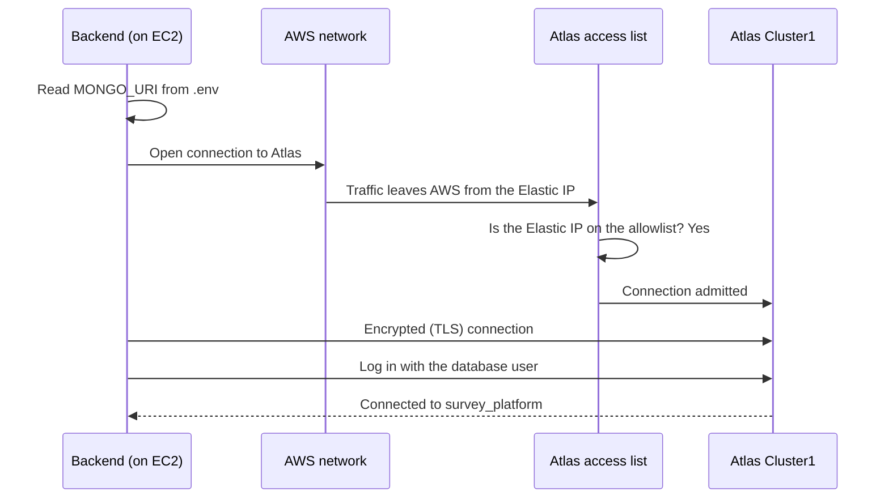

# Questionnaire Platform: Production Deployment on AWS and MongoDB Atlas

> **Platform:** Questionnaire Platform (named **Survey Platform** in AWS)
> **Production URL:** <https://questionnaire.marketeers-ba.com>
> **Deployed by:** Farida Khaled
> **Go-live period:** July 1st – July 10th

This document records how the Questionnaire Platform was moved from a local environment to production on AWS EC2, with its database hosted on MongoDB Atlas. It describes each stage in the order it was carried out, the configuration chosen, and the reason for each choice.

---

## 1. Background

### 1.1 Initial situation

The platform was first developed and run **locally** with Docker Compose. That setup included its own MongoDB container. As a result:

- the data lived on a single machine, with no managed backup or redundancy;
- the platform could only be reached on the local network;
- there was no public domain and no trusted SSL certificate.

### 1.2 Objective

Make the platform publicly available on the company domain over HTTPS, with its data in a managed cloud database.

### 1.3 Solution adopted

| Area | Solution |
|------|----------|
| Database | **MongoDB Atlas**, a managed cluster that replaced the local MongoDB container |
| Application hosting | **AWS EC2**, an Ubuntu instance running the existing Docker Compose stack |
| Public address | **Elastic IP**, a fixed address for the domain and the database allowlist |
| Domain | **Route 53** record `questionnaire.marketeers-ba.com` |
| HTTPS | **Nginx** with a **Let's Encrypt** certificate issued by **Certbot** |

### 1.4 Responsibilities

| Party | Responsibility |
|-------|----------------|
| Developer | MongoDB Atlas, EC2 resources, server setup, application deployment, SSL |
| Team leader | Route 53 DNS record (they hold Route 53 access) |

### 1.5 Resulting architecture



---

## 2. Deployment Summary

| Stage | Work carried out | Platform |
|-------|------------------|----------|
| 1 | Database cluster created and data migrated | MongoDB Atlas |
| 2 | Codebase switched from local MongoDB to Atlas | Codebase |
| 3 | SSH key pair created | AWS EC2 |
| 4 | Security group created | AWS EC2 |
| 5 | EC2 instance launched | AWS EC2 |
| 6 | Elastic IP allocated and associated | AWS EC2 |
| 7 | Elastic IP added to the database allowlist | MongoDB Atlas |
| 8 | Domain pointed to the Elastic IP | Route 53 (team leader) |
| 9 | Server accessed and prepared | Server (Ubuntu) |
| 10 | Application code deployed and configured | Server (Ubuntu) |
| 11 | SSL configured with Certbot and Nginx | Server (Ubuntu) |
| 12 | Platform started | Server (Ubuntu) |
| 13 | Deployment verified | Browser + server |

---

## Stage 1: Database Migration to MongoDB Atlas

### 1.1 Cluster creation

A cluster named **Cluster1** was created in MongoDB Atlas with the following settings:

| Setting | Value |
|---------|-------|
| Tier | Free |
| Cloud provider | AWS |
| Region | Paris (eu-west-3), the same region as the EC2 instance, to keep latency low |
| Topology | Replica set, 3 nodes |
| Database | `survey_platform` |

### 1.2 Database user

A dedicated database user was created under **Security → Database Access**. It uses password authentication and has read/write privileges. Its credentials are used only inside the connection string.

### 1.3 Temporary network access

The developer's own IP address was temporarily added under **Security → Network Access**, so the data could be uploaded from the local machine.

### 1.4 Data export and import

The local database was exported to a single archive file:

```bash
mongodump --uri="mongodb://localhost:27018/survey_platform" --archive=dump.archive
```

The archive was then restored into Atlas with the cluster's connection string:

```bash
mongorestore --uri="<atlas-connection-string>" --archive=dump.archive
```

`dump.archive` is excluded from Git and from Docker images.

### 1.5 Validation

The `survey_platform` database and all of its collections were confirmed in **Cluster1 → Browse Collections**.

---

## Stage 2: Codebase Connected to Atlas

The following changes were made to the repository:

1. The local `mongodb` service was removed from [infra/docker/docker-compose.yml](../../infra/docker/docker-compose.yml), so the backend no longer depended on a local database.
2. Hard-coded local IP addresses in Compose were replaced with production values.
3. The Atlas connection string was stored in the root `.env` file, which the backend reads through [backend/config.py](../../backend/config.py):

```dotenv
MONGO_URI=mongodb://<db-user>:<db-password>@<atlas-node-1>,<atlas-node-2>,<atlas-node-3>/survey_platform?ssl=true&replicaSet=<replica-set-name>&authSource=admin&retryWrites=true&w=majority
DATABASE_NAME=survey_platform
```

The standard (non-SRV) connection string was chosen. It lists the three cluster nodes directly, so startup does not depend on a special DNS lookup. The backend container was also configured to use public DNS servers.

---

## Stage 3: SSH Key Pair

A key pair was created under **EC2 → Key Pairs**:

| Setting | Value |
|---------|-------|
| Name | `survey-key` |
| Type | RSA |
| Format | `.pem` |

The private key `survey-key.pem` was downloaded once, at creation, and stored securely. AWS keeps no copy. The file's permissions were restricted so SSH would accept it:

```bash
chmod 400 survey-key.pem
```

---

## Stage 4: Security Group

A security group was created to act as the instance's firewall.

| Setting | Value |
|---------|-------|
| Name | `Survey_Platform` |
| Description | Security group for survey platform web traffic and SSH access |
| VPC | Default VPC |

**Inbound rules**

| Type | Protocol | Port | Source | Purpose |
|------|----------|------|--------|---------|
| HTTP | TCP | 80 | `0.0.0.0/0` (anywhere) | Public web traffic, Let's Encrypt domain validation, and the redirect to HTTPS |
| HTTPS | TCP | 443 | `0.0.0.0/0` (anywhere) | All user traffic to the platform |
| SSH | TCP | 22 | Developer's IP only (`/32`) | Server administration over SSH |

**Outbound rules:** the default rule (all traffic) was kept. The server needs it to reach MongoDB Atlas, GitHub, Docker Hub, and Let's Encrypt.

The internal service ports (backend, frontend, Redis) were deliberately left closed, so all public traffic passes through Nginx.

---

## Stage 5: EC2 Instance

The instance was launched from **EC2 → Instances → Launch instances**:

| Section | Configuration |
|---------|---------------|
| Name | `Survey Platform` |
| OS image (AMI) | Ubuntu Server (64-bit x86, SSD gp3) |
| Instance type | `t3.medium` (2 vCPU, 4 GiB RAM) |
| Key pair | `survey-key` |
| Network | Default VPC and subnet, Paris region (eu-west-3) |
| Firewall | Existing security group `Survey_Platform` |
| Storage | One root EBS volume, 30 GiB, gp3 |
| Metadata | IMDSv2 required |

The instance reached **Running** with **3/3 status checks passed**.

`t3.medium` was chosen because the platform runs five containers. Two of them include a headless browser for report export, which needs more memory than smaller instance types provide.

### Storage configuration

The instance type sets CPU and memory only. t3 instances have no built-in disk, so storage was provided by an **EBS volume**, a network-attached disk, set in the **Configure storage** section of the launch wizard.

| Choice | Selected | Meaning |
|--------|----------|---------|
| Number of volumes | 1 (root volume only) | A single disk holds everything on the server |
| Root device name | `/dev/sda1` | The disk the server boots from |
| Root device type | EBS | A persistent, network-attached disk. Data survives stop/start. |
| Volume size | 30 GiB | Room for Ubuntu, Docker images (including the headless browser), the application code, and generated reports |
| Volume type | gp3 (SSD) | General-purpose SSD, the AMI default |
| EBS optimization | Enabled | Dedicated bandwidth between the instance and its disk |
| Encrypted | No | The disk is not encrypted at rest |
| Delete on termination | Yes | If the instance is terminated, the disk is deleted with it |

The survey data does not live on this disk. It is stored in MongoDB Atlas, independently of the server.

The volume is shown under **EC2 → Instances → Survey Platform → Storage** tab. It can be managed from the instance's right-click menu under **Storage** (Attach volume, Detach volume, Replace root volume).

---

## Stage 6: Elastic IP

The instance's default public IP changes every time the instance is stopped and started. The domain and the Atlas allowlist both need an address that never changes, so an Elastic IP was assigned:

1. An Elastic IP was allocated under **EC2 → Elastic IPs** and named **`survey-eip`**.
2. It was associated with the **Survey Platform** instance.

The instance's permanent public address became **15.236.219.93**.

---

## Stage 7: Elastic IP Allowed in MongoDB Atlas

The Elastic IP was added under **Atlas → Security → Network Access** as **`15.236.219.93/32`**, which allows only that exact address. From then on, the production server was the only source that could reach the database apart from approved administrator IPs.

### How the connection works



1. The backend reads `MONGO_URI` from `.env` and opens a connection to the Atlas cluster.
2. Inside AWS, the server has only a private address. When its traffic leaves AWS, AWS sends it from the instance's **Elastic IP**.
3. Atlas checks that address against its **Network Access** allowlist, finds it, and admits the connection. Atlas refuses connections from any other address.
4. The connection is **encrypted with TLS** (`ssl=true`).
5. The backend **authenticates** with the database user from the connection string.
6. The driver finds the cluster's primary node and works with the `survey_platform` database.

---

## Stage 8: Domain Configuration (Route 53)

The Elastic IP was sent to the team leader, who holds Route 53 access. They created the DNS record and confirmed:

> *"questionnaire.marketeers-ba.com has been created and configured. It now points directly to the EC2 Elastic IP: 15.236.219.93. You can now configure the web server and SSL on the instance."*

| Record | Type | Points to |
|--------|------|-----------|
| `questionnaire.marketeers-ba.com` | A | `15.236.219.93` |

---

## Stage 9: Server Access and Preparation

### 9.1 Access

The server was accessed in two ways.

**SSH with the downloaded key:**

```bash
ssh -i survey-key.pem ubuntu@15.236.219.93
```

**EC2 Instance Connect:** the browser terminal in the EC2 console, opened from **Instances → Survey Platform → Connect** with the user `ubuntu`.

### 9.2 Preparation

Ubuntu was updated, and the required tools were installed:

```bash
# System update
sudo apt update && sudo apt upgrade -y

# Git and Certbot
sudo apt install -y git curl certbot

# Docker and Docker Compose
curl -fsSL https://get.docker.com | sudo sh
sudo usermod -aG docker ubuntu
sudo systemctl enable --now docker
```

---

## Stage 10: Application Deployment and Configuration

### 10.1 Code

The repository was cloned onto the server:

```bash
cd ~
git clone https://github.com/MarketeersBA/Questionnaire-Platform.git
cd Questionnaire-Platform
```

### 10.2 Environment file

`.env` is not stored in Git, so it was created on the server from `env.example`, and its permissions were restricted:

```bash
cp env.example .env
nano .env
chmod 600 .env
```

| Variable | Content |
|----------|---------|
| `MONGO_URI` | Atlas connection string |
| `DATABASE_NAME` | `survey_platform` |
| `SECRET_KEY` | Long random string |
| `ADMIN_USERNAME` / `ADMIN_PASSWORD` | Production admin credentials |
| `OPENAI_API_KEY` | Key for AI analytics |
| `GOOGLE_CLIENT_ID` | Google sign-in client ID |

### 10.3 Production settings in the codebase

The production domain was configured in the Compose file and the frontend:

| Setting | Location | Purpose |
|---------|----------|---------|
| `ALLOWED_ORIGINS=https://questionnaire.marketeers-ba.com` | docker-compose.yml | Only the production site may call the API |
| `PPTX_EXPORT_FRONTEND_BASE_URL=https://questionnaire.marketeers-ba.com` | docker-compose.yml | Public links inside exported reports |
| `REDIS_URL=redis://redis:6379/0` | docker-compose.yml | Internal Redis container |
| `restart: unless-stopped` | docker-compose.yml | Containers restart on their own after a failure or a reboot |
| Domain added to `allowedHosts` | [frontend/vite.config.ts](../../frontend/vite.config.ts) | The frontend accepts requests for the domain |

---

## Stage 11: SSL with Certbot and Nginx

### 11.1 Certificate issuance

Once the domain resolved to the Elastic IP and port 80 was open, a Let's Encrypt certificate was issued with Certbot. This was done before the platform was started, while port 80 was still free:

```bash
sudo certbot certonly --standalone -d questionnaire.marketeers-ba.com
```

Let's Encrypt confirmed that the domain was under our control, then issued the certificate to:

```text
/etc/letsencrypt/live/questionnaire.marketeers-ba.com/fullchain.pem
/etc/letsencrypt/live/questionnaire.marketeers-ba.com/privkey.pem
```

### 11.2 Certificate provided to Nginx

The Nginx container was configured in [docker-compose.yml](../../infra/docker/docker-compose.yml) to load its configuration file and the server's certificate folder:

```yaml
nginx:
  image: nginx:alpine
  ports:
    - "443:443"
    - "80:80"
  volumes:
    - ../../infra/nginx/nginx.dev.conf:/etc/nginx/nginx.conf:ro
    - /etc/letsencrypt:/etc/letsencrypt:ro
```

### 11.3 Nginx configuration

[infra/nginx/nginx.dev.conf](../../infra/nginx/nginx.dev.conf) was configured with three responsibilities.

**HTTP to HTTPS redirect**

```nginx
server {
    listen 80;
    server_name questionnaire.marketeers-ba.com;
    location / {
        return 301 https://$host$request_uri;
    }
}
```

**HTTPS with the Let's Encrypt certificate**

```nginx
server {
    listen 443 ssl;
    server_name questionnaire.marketeers-ba.com;

    ssl_certificate     /etc/letsencrypt/live/questionnaire.marketeers-ba.com/fullchain.pem;
    ssl_certificate_key /etc/letsencrypt/live/questionnaire.marketeers-ba.com/privkey.pem;
    ssl_protocols TLSv1.2 TLSv1.3;
    ...
}
```

**Request routing**

| Request path | Routed to |
|--------------|-----------|
| `/api/...` | Backend, with the `/api` prefix removed |
| Everything else | Frontend |

Users only ever connect to `https://questionnaire.marketeers-ba.com`. Nginx forwards each request to the right service inside the server.

### 11.4 Certificate renewal

Let's Encrypt certificates are valid for 90 days. Renewal needs port 80, so Nginx is stopped while the certificate renews and started again afterwards:

```bash
sudo certbot renew \
  --pre-hook  "docker stop questioner_nginx" \
  --post-hook "docker start questioner_nginx"
```

---

## Stage 12: Platform Start-up

The full stack was built and started from the Compose directory:

```bash
cd ~/Questionnaire-Platform/infra/docker
docker compose up -d --build
```

| Container | Role |
|-----------|------|
| `questioner_nginx` | HTTPS entry point and request routing |
| `questioner_frontend` | User interface |
| `questioner_backend` | API, connected to MongoDB Atlas |
| `questioner_pptx_worker` | Background report generation |
| `questioner_redis` | Queue and cache |

---

## Stage 13: Verification

The deployment was checked as follows:

| Check | Method | Result |
|-------|--------|--------|
| Domain | `nslookup questionnaire.marketeers-ba.com` | Resolves to the Elastic IP |
| HTTPS redirect | Opening `http://questionnaire.marketeers-ba.com` | Redirected to `https://` |
| SSL | Opening the site in a browser | Valid certificate (padlock shown) |
| API | `https://questionnaire.marketeers-ba.com/api/` | "Survey Platform API is running" |
| Database | `https://questionnaire.marketeers-ba.com/api/health` | `"database": "connected"` |
| Application | Admin login | Surveys loaded from Atlas |
| Atlas | Cluster1 → View Monitoring | Active connections from the server |

---

## Appendix: Releasing Updates

New versions are deployed to the server with:

```bash
ssh -i survey-key.pem ubuntu@15.236.219.93
cd ~/Questionnaire-Platform
git pull origin main
cd infra/docker
docker compose up -d --build
```
